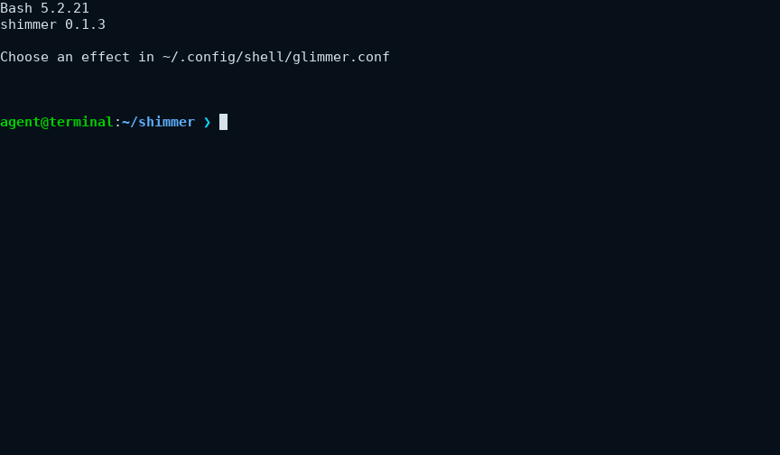

# Shimmer

Shimmer plays a short animation before an interactive Bash prompt. Choose a cyan, lime, and white sweep or colorful 3D fragments that assemble into your prompt. A native Rust binary draws the animation. A Bash hook runs it once, after your existing prompt hooks.

Shimmer needs Bash 5.1 or newer and an ANSI terminal with an alternate screen. It runs on Linux and macOS, inside or outside tmux. macOS ships Bash 3.2, so install a current Bash and use it as your interactive shell first. Installed releases need neither Rust nor Python.

## Watch the effects

Assemble moves colored fragments into the position of your Bash prompt.



Shimmer sweeps cyan, white, and lime across the terminal, then restores your shell.


Open the [assemble still](docs/demos/assemble.png), [shimmer still](docs/demos/shimmer.png), or [recording instructions and capture details](docs/demos/README.md).

## Install a release

Choose your platform target below. The [latest release](https://github.com/mamachanko/shimmer/releases/latest) provides an installable archive and its `.sha256` file for each target.

| Platform | Bundle target |
| --- | --- |
| Linux Intel or AMD 64-bit | `x86_64-unknown-linux-musl` |
| Linux ARM 64-bit | `aarch64-unknown-linux-musl` |
| macOS Intel | `x86_64-apple-darwin` |
| macOS Apple silicon | `aarch64-apple-darwin` |

Replace `TARGET` in these commands with your platform target. Download the archive and checksum.

```sh
curl -fLO https://github.com/mamachanko/shimmer/releases/latest/download/shimmer-TARGET.tar.gz
curl -fLO https://github.com/mamachanko/shimmer/releases/latest/download/shimmer-TARGET.tar.gz.sha256
sha256sum --check shimmer-TARGET.tar.gz.sha256
```

On macOS, use `shasum -a 256 --check` instead of `sha256sum --check`. Then extract and install the bundle.

```sh
mkdir -p shimmer-install
tar -xzf shimmer-TARGET.tar.gz --strip-components=1 -C shimmer-install
sh shimmer-install/install.sh
```

The installer writes `~/.local/bin/shimmer` and `~/.config/shell/shimmer.bash`. It creates `~/.config/shell/shimmer.conf` only if that file does not exist. It places one guarded source line at the end of `~/.bashrc`, after existing prompt hooks. You can rerun the installer to update Shimmer.

Open a new interactive Bash shell. To change the animation, set `effect=assemble`, `effect=shimmer`, or `effect=off` in `~/.config/shell/shimmer.conf`. See [prompt configuration and terminal limits](docs/shell-shimmer.md) for previews and prompt behavior.

## Build from source

Install a current stable Rust toolchain and GNU Make, then run these commands from the repository root.

```sh
make build
make install
~/.local/bin/shimmer --version
```

`make build` uses the committed Cargo lockfile and builds `target/release/shimmer` with the release profile. `make install` builds that binary and runs the same installer as the release bundle. To inspect an installation without changing your shell, use a separate home directory.

```sh
HOME="$(mktemp -d)" sh scripts/install.sh
```

The renderer accepts the effect and an already expanded prompt as two literal arguments. The Bash hook supplies the prompt automatically.

```sh
target/release/shimmer assemble 'user@host:~$ '
target/release/shimmer shimmer ''
target/release/shimmer --help
```

## Check a change

Run the formatting, lint, and Rust test checks.

```sh
make test
```

The terminal integration suite also needs Python 3 and tmux as development tools. It runs the optimized binary in interactive terminals.

```sh
make terminal-test
```

To create and check a local bundle, run these commands.

```sh
make package
sh .github/scripts/check-install.sh "$PWD/target/release/shimmer" "$PWD/dist/shimmer-$(rustc -vV | sed -n 's/^host: //p').tar.gz"
```

## Download a CI build

Every push and pull request runs formatting, Clippy, Rust tests, terminal integration tests, and four native release builds. Open [the build workflow](https://github.com/mamachanko/shimmer/actions/workflows/ci.yml), select a run, and download its platform artifact. Each artifact contains an installable archive with a versioned directory and its SHA-256 checksum.

A successful push to `main` also publishes a GitHub release. You can run the same workflow manually on `main`. The version is `0.1.<workflow run number>`. Run numbers can have gaps because other branches and pull requests use the workflow too. Reruns reuse the version and replace its assets. An older rerun does not replace a newer release as the latest release.

CI sets `SHIMMER_VERSION` when compiling the binary. Local builds default to `0.1.0`, and `make build VERSION=0.1.123` builds a specific version. `Cargo.toml` keeps the development version `0.1.0` and disables crate publication. Releases need no version commits, release pull requests, or extra token.

Shimmer is distributed under the [MIT license](LICENSE).
